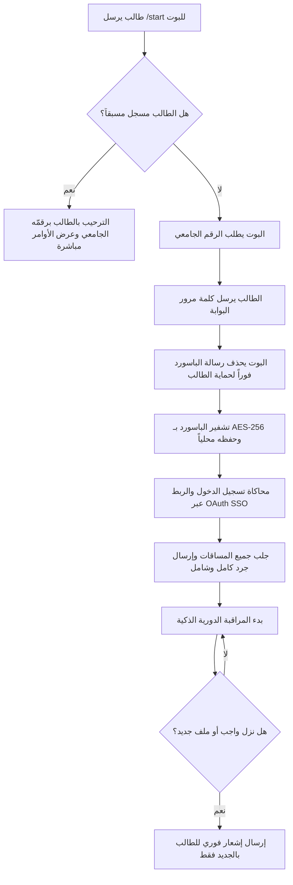

# 🎓 بوت إشعارات يوبينار جامعة فلسطين (UPINAR Notifier)

<div align="center">


<br/>


**بوت تيليجرام ذكي ومتكامل لطلاب جامعة فلسطين لمتابعة مساقات الموديل (اليوبينار UPINAR) تلقائياً، وإرسال إشعارات فورية بكل واجب، كويز، محاضرة، إعلان، أو شبتر جديد.**

[📱 للطلاب: كيف تستخدم البوت](#-للطلاب-كيف-تستخدم-البوت-بضغطة-زر-واحدة-بدون-أي-تحميل) • [المميزات](#-المميزات-الرئيسية) • [دليل الأوامر](#-دليل-أوامر-البوت) • [الأمان والخصوصية](#-الأمان-وحماية-البيانات-security--privacy) • [استضافة وتشغيل البوت](#-للمطورين-وأصحاب-الخوادم-طريقة-تشغيل-واستضافة-البوت-247)

</div>

---

## 📱 للطلاب: كيف تستخدم البوت بضغطة زر واحدة؟ (بدون أي تحميل!)

> [!IMPORTANT]
> ### ❓ هل يحتاج الطالب لتنزيل أي ملفات أو تشغيل أي برامج على جهازه؟
> **لا طبعاً وبشكل قاطع!** 🚫💻  
> الطلاب في الجامعة **لا يحتاجون لتنزيل أي كود أو بايثون أو أي ملفات إطلاقاً**. كل ما يحتاجه أي طالب في هاتفه أو حاسوبه هو تطبيق **Telegram** فقط!
> 
> * **من الذي يشغل الملفات إذن؟**  
>   مستضيف البوت فقط (السيرفر المركزي أو هاتف المطور)، ويعمل البوت في الخلفية لخدمة جميع طلاب جامعة فلسطين في نفس اللحظة عبر تطبيق التيليجرام.
> * **ما فائدة التعليمات البرمجية وأكواد بايثون في هذا المستودع؟**  
>   المشروع مفتوح المصدر (Open-Source)، والتعليمات البرمجية بالأسفل مخصصة فقط للمطورين وأصحاب الخوادم (Developers / Hosts) إذا أراد مبرمج آخر استضافة نسخة خاصة به.

---

### 🚀 خطوات استخدام البوت لأي طالب (في 10 ثوانٍ فقط):

1. **افتح تطبيق التيليجرام** على هاتفك (Android / iPhone) أو حاسوبك، وادخل على البوت:  
   👉 **[@up_notifier_bot](https://t.me/up_notifier_bot)**
2. اضغط على زر **Start** (أو أرسل أمر `/start`).
3. أرسل **رقمك الجامعي** (مثال: `120251381` - يقبل الأرقام العربية والإنجليزية والمسافات تلقائياً).
4. أرسل **كلمة مرور بوابة الطالب** *(تُحذف الرسالة تلقائياً وتُشفر فوراً لحمايتك)*.
5. 🎉 **مبروك! انتهى الأمر!**  
   في ثوانٍ معدودة سيتصل البوت بحسابك ويرسل لك تقريراً شاملاً بكافة مساقاتك والواجبات والمحاضرات المتوفرة، وسيبدأ بمراقبتها تلقائياً ليرسل لك تنبيهاً فورياً بأي جديد دون أي تدخل منك!

> [!TIP]
> **ذكاء البوت وتذكر الحساب:**  
> بمجرد تسجيلك لأول مرة، يحفظ البوت بياناتك مشفرة؛ فلن يطلب منك رقمك الجامعي أو كلمة المرور مرة أخرى إطلاقاً إذا أرسلت `/start` مستقبلاً، بل سيرحب بك مباشرة ويعرض لك لوحة تحكم حسابك. وإذا أردت في أي وقت مسح بياناتك أو تبديل الحساب، يمكنك ببساطة إرسال أمر `/logout`.

---

## 📖 نظرة عامة (Overview)

صُمم هذا المشروع لحل مشكلة التأخر في متابعة منصة اليوبينار (`upinar.edu.ps`) وبوابة الطالب (`students.up.edu.ps`) لطلاب **جامعة فلسطين**. 

يقوم البوت بمحاكاة تسجيل الدخول الموحد (SSO)، جرد محتويات جميع المساقات المسجلة للطالب، وحفظها محلياً في قاعدة بيانات سريعة ومشفرة، ثم مراقبة أي تحديثات أو تكليفات جديدة ونشرها فوراً على حساب التيليجرام الخاص بكل طالب بشكل منفصل ومستقل.

---

## ✨ المميزات الرئيسية

* 👥 **نظام متعدد الطلاب (Multi-Student / Multi-Tenant):**
  يدعم البوت عدداً غير محدود من الطلاب في نفس الوقت؛ فلكل طالب حسابه الخاص، بياناته المشفرة، ومساقاته المعزولة تماماً.
* 🔐 **تسجيل دخول موحد آمن (SSO Login):**
  ربط تلقائي وذكي بين بوابة الطالب الرسمية ونظام اليوبينار (Moodle SSO)، مع دعم كامل لتخطي شاشات التفويض (OAuth Authorization Consent) آلياً وتخطي أخطاء الـ Cookies المتضاربة.
* 🛡️ **تشفير عسكري وحذف فوري للباسورد:**
  تُحذف رسالة كلمة المرور من محادثة التيليجرام فور استلامها مباشرة، وتُشفر بقوة **AES-256 (Fernet)** قبل حفظها بقاعدة البيانات.
* 🧠 **حفظ الجلسة وتذكر الطلاب (Smart Memory):**
  لا يطلب البوت إعادة إدخال بيانات الاعتماد؛ فعند إرسال أمر `/start` يتعرف على الطالب المسجل فوراً ويرحب به برقمّه الجامعي، مع إتاحة أمر `/logout` للخروج بأمان في أي وقت.
* 🛑 **حماية متكاملة ومكافحة السبام (Anti-Spam & Rate Limiting):**
  - **فاصل زمني عام (5 ثوانٍ):** يمنع الضغط العشوائي والمتتالي على الأوامر.
  - **قفل العمليات المتزامنة (`Concurrency Lock`):** يمنع إرسال طلبات فحص متزامنة من نفس الطالب أثناء معالجة طلب سابق.
  - **فترات تبريد (Cooldowns):** منع إرهاق خوادم الجامعة (15 دقيقة لـ `/check`، و 20 دقيقة لـ `/report`).
  - **حظر الوسائط والملفات:** حذف تلقائي فوري لأي صور، فيديوهات، أو ملصقات تُرسل للبوت لضمان سلامة وأمان المنصة.
  - **فلترة الأوامر المجهولة:** توجيه الطالب لقائمة الأوامر الصحيحة عند كتابة أوامر غير معروفة.
* 📦 **جرد شامل وفوري للمواد (Baseline Inventory):**
  فور اكتمال التسجيل، يرسل البوت بطاقات منسقة لكل مساق مقسمة حسب النوع (واجبات، كويزات، شباتر/ملفات، محاضرات وتسجيلات، إعلانات وروابط) مع نظام تفادي قيود تيليجرام (`Smart 429 Retry Backoff`).
* 🔄 **مراقبة دورية قابلة للتخصيص (Configurable Interval):**
  دعم الفحص السريع (كل 10-15 دقيقة) للتنبيه اللحظي فور رفع الدكتور للمحاضرة، أو الفحص الموفر (كل 12 ساعة) لتوفير البيانات، مع منع التكرار (Deduplication).
* ⚡ **تنبيهات فورية دقيقة:**
  تنبيه مباشر يوضح اسم المادة، نوع العنصر الجديد، عنوانه، ورابط الوصول المباشر إليه بضغطة زر.
* 📱 **دعم الاستضافة المحمولة على الجوال (Termux 24/7):**
  تشغيل البوت على هاتف أندرويد ليعمل كـ سيرفر شخصي محمول في الجيب دون انقطاع.
* 🖥️ **خدمة خلفية 24/7 مدمجة للويندوز:**
  تشغيل وإيقاف البوت كخدمة صامتة بنقرة زر واحدة ودون إبقاء أي شاشة سوداء أو طرفية مفتوحة، مع تفعيل الإقلاع التلقائي مع فتح الويندوز.

---

## 🔄 دليل عمل البوت خطوة بخطوة



---

## 🕹️ دليل أوامر البوت

| الأمر | الوظيفة | فترة التبريد (Cooldown) |
| :--- | :--- | :--- |
| `/start` | بدء الاستخدام، أو استئناف التنبيهات والترحيب بالطالب المسجل | 5 ثوانٍ |
| `/check` | إجراء فحص فوري للمساقات الآن للبحث عن أي جديد | 15 دقيقة |
| `/courses` | استعراض قائمة بجميع أسماء المواد المسجلة وروابطها المباشرة | 3 دقائق |
| `/report` | إرسال تقرير وجرد شامل لجميع محتويات وواجبات المساقات | 20 دقيقة |
| `/status` | عرض حالة المراقبة، موعد آخر فحص، وعدد العناصر المؤرشفة | 1 دقيقة |
| `/stop` | إيقاف التنبيهات الدورية مؤقتاً | 5 ثوانٍ |
| `/logout` | تسجيل الخروج وحذف بيانات حسابك بأمان لإعادة التسجيل بحساب آخر | 5 ثوانٍ |
| `/cancel` | إلغاء خطوة التسجيل الحالية | - |
| `/help` | عرض قائمة المساعدة ودليل الأوامر المعتمدة | - |

---

## 🔒 الأمان وحماية البيانات (Security & Privacy)

* **تشفير كلمات المرور:** نستخدم معيار `Fernet` القائم على خوارزمية **AES-128-CBC** و **HMAC-SHA256** (المكافئ لـ AES-256). الباسورد مخزن بصيغة غير قابلة للقراءة ولا يمكن فك تشفيره إلا باستخدام المفتاح الخاص `ENCRYPTION_KEY` المخزن في ملف `.env`.
* **الحفظ المحلي المعزول:** قاعدة البيانات تُحفظ محلياً على الجهاز أو الخادم الذي يشغل البوت فقط داخل المجلد `data/upinar.sqlite3` ومحمية بصلاحيات النظام ومستثناة من Git تماماً.
* **العزل التام بين الطلاب:** لا يستطيع أي طالب الاطلاع على بيانات أو مساقات أو تنبيهات طالب آخر، حيث ترتبط كل عملية بالـ `Chat ID` الخاص بالمرسل.
* **حذف الرسائل الحساسة:** تُحذف رسالة كلمة المرور تلقائياً من محادثة تيليجرام فور استقبالها لمنع بقائها مكشوفة في الهاتف.
* **حماية السيرفر من الحظر:** نظام الـ Rate Limiting وفواصل الفحص الهادئة تحمي حسابات الطلاب وعناوين الـ IP من التعرض للحظر من جدار حماية الجامعة (Cloudflare WAF).

---

## 💻 للمطورين وأصحاب الخوادم: طريقة تشغيل واستضافة البوت (24/7)

> [!NOTE]
> هذا القسم مخصص فقط للشخص الذي يريد استضافة وتشغيل البوت على جهازه، هاتفه، أو على خادم VPS لخدمة زملائه الطلاب.

### 1. استنساخ المستودع (Clone)
```bash
git clone https://github.com/medozaiter/upinar-notifier.git
cd upinar-notifier
```

### 2. تثبيت المتطلبات وإعداد ملف البيئة (`.env`)
```bash
cp .env.example .env
```
افتح ملف `.env` واملأ المتغيرات التالية:
```env
# توكن بوت التيليجرام المستخرج من @BotFather
TELEGRAM_BOT_TOKEN=1234567890:ABCdefGHIjklMNOpqrSTUvwxyz

# مفتاح التشفير (يمكن تركه فارغاً ليقوم البوت بتوليده تلقائياً)
ENCRYPTION_KEY=

# فترة الفحص الدوري بالدقائق:
# 10 = فحص كل 10 دقائق (إشعار لحظي فوري بالواجبات والمحاضرات)
# 720 = فحص كل 12 ساعة (وضع توفير البيانات)
CHECK_INTERVAL_MINUTES=10

# مسار ملف قاعدة البيانات
DATABASE_PATH=data/upinar.sqlite3
```

---

### 📱 التشغيل على هاتف الأندرويد عبر تطبيق Termux (سيرفر محمول 24/7):

يمكنك تحويل هاتفك الأندرويد إلى خادم استضافة دائم للبوت:

1. **تثبيت الحزم الأساسية في Termux:**
   ```bash
   pkg update -y && pkg install -y git python clang libffi openssl ca-certificates python-cryptography
   pip install requests "python-telegram-bot<22.0,>=20.0" beautifulsoup4 python-dotenv urllib3 cffi
   ```
2. **منع الأندرويد من إيقاف التطبيق:**
   ```bash
   termux-wake-lock
   ```
   *(قم أيضاً بوضع علامة القفل 🔒 على تطبيق Termux في شاشة التطبيقات المفتوحة، واضبط البطارية على "غير مقيد - Unrestricted").*
3. **تشغيل البوت كخدمة خلفية دائمة:**
   ```bash
   python -m upinar_notifier start
   ```
4. **التشغيل التلقائي بمجرد فتح Termux:**
   ```bash
   echo "cd ~/upinar-notifier && python -m upinar_notifier start" >> ~/.bashrc
   ```

---

### 🖥️ التشغيل على نظام Windows (خدمة صامتة 24/7 بنقرة زر):

يتضمن المشروع ملفات تشغيل مجهزة مسبقاً للتحكم بالبوت دون الحاجة لفتح شاشات سوداء أو نوافذ طرفية:

| الملف | الوظيفة |
| :--- | :--- |
| **`تشغيل_البوت_في_الخلفية.bat`** | تشغيل البوت فوراً في خلفية النظام بصمت تام. |
| **`فحص_حالة_البوت_والسجلات.bat`** | فحص حالة البوت وعرض رقم العملية (PID) وآخر أسطر السجل الحي. |
| **`ايقاف_البوت.bat`** | إيقاف البوت وإنهاء عمليته من الخلفية فوراً. |
| **`تفعيل_التشغيل_التلقائي_مع_الويندوز.bat`** | تشغيل البوت تلقائياً وبشكل غير مرئي في كل مرة يفتح فيها الكمبيوتر. |
| **`الغاء_التشغيل_التلقائي.bat`** | إلغاء ميزة بدء التشغيل التلقائي مع الويندوز. |

#### أو عبر سطر الأوامر (CLI):
```powershell
python -m upinar_notifier start        # تشغيل في الخلفية
python -m upinar_notifier status       # فحص الحالة والسجلات
python -m upinar_notifier stop         # إيقاف
python -m upinar_notifier autostart    # تفعيل الإقلاع التلقائي
python -m upinar_notifier run          # تشغيل تفاعلي بالواجهة
```

---

### 🐧 التشغيل على خادم Linux (VPS / Ubuntu) عبر Systemd:

1. انسخ ملف الخدمة:
```bash
sudo cp upinar-bot.service /etc/systemd/system/
```
2. عدّل المسارات داخل الملف لتطابق مسار المجلد واسم المستخدم:
```bash
sudo nano /etc/systemd/system/upinar-bot.service
```
3. فعّل الخدمة وشغّلها:
```bash
sudo systemctl daemon-reload
sudo systemctl enable upinar-bot
sudo systemctl start upinar-bot
```

---

## 🛡️ تقرير الفحص الأمني واختبار الاختراق (Cybersecurity & Pentesting Audit)

تم إجراء تدقيق أمني شامل واختبارات اختراق دفاعية للكود البرمجي (Security Code Review) لضمان أعلى معايير الحماية والأمان لبيانات الطلاب:

1. **🔒 حماية البيانات والتشفير (AES-256 Fernet + HMAC-SHA256):**
   * كلمات المرور وكوكيز الجلسات تُشفر فورياً داخل قاعدة البيانات المشفرة ولا تُخزن بصيغة نصية مجردة (Plaintext) نهائياً.
   * يتم حذف رسالة كلمة المرور من محادثة التيليجرام فور استلامها لحماية خصوصية الطالب.
2. **💉 منع هجمات حقن قواعد البيانات (SQL Injection - 0% Surface):**
   * جميع الاستعلامات في قاعدة بيانات SQLite تستخدم الاستعلامات المجهزة والمعلمة (Parameterized Queries) حصراً، مما يجعل حقن SQL مستحيلاً.
3. **🧹 تعقيم المدخلات الذكي (Input Sanitization & Normalization):**
   * تحويل تلقائي للأرقام العربية المشرقية (١٢٠٢٥١٣٨١) إلى أرقام إنجليزية (120251381).
   * إزالة كافة المسافات العشوائية (في البداية، المنتصف، والنهاية) ورموز النسخ واللصق الخفية (Unicode BiDi / LTR / RTL marks).
   * فحص صارم لطول ونوع المدخلات لمنع هجمات فيض الذاكرة (Buffer/Memory Overflow).
4. **🛑 منع هجمات الحرمان من الخدمة والتكرار (Anti-DoS & Concurrency Locks):**
   * نظام أقفال غير متزامنة (asyncio.Lock) لكل طالب على حدة يمنع إرسال أوامر متزامنة في نفس اللحظة.
   * نظام فترات تهدئة ذكي (Cooldowns):
     * مهلة عامة بين أي أمرين (5 ثوانٍ).
     * فحص يدوي (/check): كل 15 دقيقة.
     * تقرير جرد شامل (/report): كل 20 دقيقة.
     * عرض المساقات (/courses): كل 3 دقائق.
     * استعلام الحالة (/status): كل دقيقة واحدة.
5. **🛡️ منع حقن نصوص التيليجرام (HTML Injection / XSS Prevention):**
   * تعقيم وتشفير جميع النصوص المسترجعة من اليوبينار (أسماء المواد، الواجبات، الملفات) بواسطة `html.escape()` قبل إرسالها للتيليجرام لمنع أي كسر لتنسيق الرسائل.
6. **🌐 تعزيز استقرار الشبكة (Safe Auto-Retry & Global Error Handling):**
   * معالجة انقطاعات الإنترنت اللحظية وإعادة المحاولة التلقائية لمنع تجميد المحادثة.

---

## 🆕 سجل التحديثات الأخير (Latest Changelog)

* **⚡ معالجة قيود تيليجرام وضمان وصول كافة المساقات (Smart 429 Retry Backoff):**
  حل مشكلة سقوط أول 3 مساقات في تقرير الجرد الكامل وضمان تسليم جميع بطاقات المساقات الـ 11 بالترتيب دون أي انقطاع.
* **🔗 التحقق الصارم من الروابط والكيانات (URL Entity Fallback):**
  فحص روابط المحاضرات والملفات تلقائياً وتفادي أخطاء الـ Bad Request عبر الإرسال التلقائي كنص منقى في حال وجود روابط خاصة.
* **🔔 التنبيه اللحظي الفوري للعناصر الجديدة:**
  إرسال إشعارات التنبيه الفردية فورياً حتى عند طلب التقرير الشامل في حال وجود مواد غير مؤرشفة.
* **📱 دليل الاستضافة السحابية والمحمولة عبر Termux:**
  توثيق تشغيل البوت كخادم خلفي 24/7 على هواتف الأندرويد مع ميزات منع نوم المعالج (Wake Lock) والإقلاع التلقائي.
* **⭐ دعم التقييم والنجمة على GitHub:**
  إضافة زر تفاعلي مباشر (InlineKeyboardButton) في رسالة البداية وضبط وصف البوت على التيليجرام لدعوة الطلاب لتقييم المشروع بنجمة.
* **⚡ الفلترة والتعقيم التلقائي للأرقام العربية والمسافات:**
  قبول كافة أنواع الأرقام والمسافات وتحويلها فوراً مع رسالة تأكيد مرئية للطالب برقمها المنقى.
* **🛡️ نظام أقفال التزامن (Per-User Concurrency Locks):**
  منع إرسال أكثر من أمر في نفس اللحظة من نفس الطالب مع رسائل تنبيه واضحة ومهذبة تبين الثواني المتبقية.
* **🍪 حل مشكلة الكوكيز المزدوجة ومودل:**
  معالجة مشكلة `CookieConflictError` و `Redirect Loop` لضمان استقرار الاتصال 24/7.
* **🧪 إضافة حزمة اختبارات أمنية آلية (`test_security.py`):**
  لاختبار التشفير، التعقيم، وحماية قواعد البيانات تلقائياً.

---

## 📜 الترخيص (License)

هذا المشروع مرخص تحت رخصة **MIT** - راجع ملف [LICENSE](LICENSE) للمزيد من التفاصيل.

<div align="center">
صُنع بـ ❤️ لخدمة وتسهيل المسيرة التعليمية لطلاب جامعة فلسطين.
</div>
