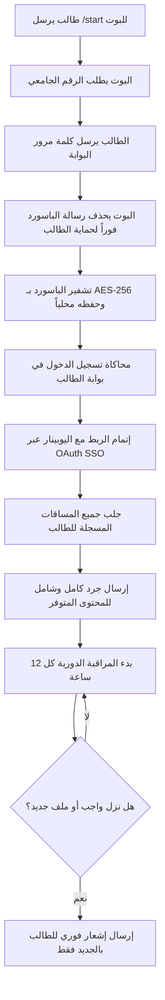

# 🎓 بوت إشعارات يوبينار جامعة فلسطين (UPINAR Notifier)

<div align="center">


**بوت تيليجرام ذكي ومتكامل لطلاب جامعة فلسطين لمتابعة مساقات الموديل (اليوبينار UPINAR) تلقائياً، وإرسال إشعارات فورية بكل واجب، كويز، محاضرة، إعلان، أو شبتر جديد.**

[المميزات](#-المميزات-الرئيسية) • [دليل عمل البوت](#-دليل-عمل-البوت-خطوة-بخطوة) • [دليل الأوامر](#-دليل-أوامر-البوت) • [الأمان والخصوصية](#-الأمان-والخصوصية) • [التثبيت والتشغيل](#-طريقة-التثبيت-والتشغيل)

</div>

---

## 📖 نظرة عامة (Overview)

صُمم هذا المشروع لحل مشكلة التأخر في متابعة منصة اليوبينار (`upinar.edu.ps`) وبوابة الطالب (`students.up.edu.ps`) لطلاب **جامعة فلسطين**. 

يقوم البوت بمحاكاة تسجيل الدخول الموحد (SSO)، جرد محتويات جميع المساقات المسجلة للطالب، وحفظها محلياً في قاعدة بيانات سريعة ومشفرة، ثم مراقبة أي تحديثات أو تكليفات جديدة ونشرها فوراً على حساب التيليجرام الخاص بكل طالب بشكل منفصل ومستقل.

---

## ✨ المميزات الرئيسية

* 👥 **نظام متعدد الطلاب (Multi-Student / Multi-Tenant):**
  يدعم البوت عدداً غير محدود من الطلاب في نفس الوقت؛ فلكل طالب حسابه الخاص، بياناته المشفرة، ومساقاته المعزولة تماماً.
* 🔐 **تسجيل دخول موحد آمن (SSO Login):**
  ربط تلقائي وذكي بين بوابة الطالب الرسمية ونظام اليوبينار (Moodle SSO)، مع دعم كامل لتخطي شاشات التفويض (OAuth Authorization Consent) آلياً.
* 🛡️ **تشفير عسكري وحذف فوري للباسورد:**
  تُحذف رسالة كلمة المرور من محادثة التيليجرام فور استلامها مباشرة، وتُشفر بقوة **AES-256 (Fernet)** قبل حفظها بقاعدة البيانات.
* 📦 **جرد شامل وفوري للمواد (Baseline Inventory):**
  فور اكتمال التسجيل، يرسل البوت بطاقات منسقة لكل مساق مقسمة حسب النوع (واجبات، كويزات، شباتر/ملفات، محاضرات وتسجيلات، إعلانات وروابط).
* 🔄 **مراقبة دورية ذكية (Configurable Interval):**
  فحص دوري قابل للتعديل (افتراضياً كل 12 ساعة) ومقارنة ذكية بالعناصر السابقة (Deduplication) لضمان عدم إرسال تنبيهات مكررة.
* ⚡ **استجابة وتنبيهات فورية:**
  تنبيه مباشر يوضح اسم المادة، نوع العنصر الجديد، عنوانه، ورابط الوصول المباشر إليه بضغطة زر.
* 🚀 **أداء خفيف وسريع:**
  مبني باستخدام بايثون 3 وقاعدة بيانات SQLite تعمل بنظام **WAL Mode** لضمان سرعة القراءة والكتابة ومنع قفل الجداول المتزامنة.

---

## 🔄 دليل عمل البوت خطوة بخطوة



### 1. بدء المحادثة (`/start`):
يبدأ الطالب بإرسال أمر `/start` إلى البوت، فيرحب به البوت ويطلب رقمه الجامعي.

### 2. إدخال كلمة المرور والحماية:
يرسل الطالب كلمة مرور بوابة الطالب الخاصة به. فور وصولها:
- يقوم البوت بحذف الرسالة من الدردشة تلقائياً لحماية خصوصية الطالب.
- يتم تشفير كلمة المرور عبر خوارزمية **AES-256** وحفظها داخل قاعدة البيانات.

### 3. المصادقة والربط السريع:
يقوم محرك المصادقة (`MoodleAuth`) بالاتصال ببوابة الطالب وتأكيد صحة البيانات، ثم يتابع رابط الـ OAuth إلى نظام اليوبينار ويعتمد التفويض تلقائياً ويحصل على جلسة الطالب.

### 4. إرسال تقرير البداية الشامل:
يقوم البوت بسحب كل المساقات وفحص كافة عناصرها، ويرسل للطالب تقريراً منظماً يحتوي على:
- 📝 **الواجبات والتكليفات (Assignments)** مع روابط التسليم.
- ⏱️ **الاختبارات والكويزات (Quizzes)**.
- 📁 **الشباتر والملفات (Files & Folders)**.
- 🎥 **المحاضرات والتسجيلات والروابط (Recordings & URLs)**.
- 📢 **الإعلانات والمنتديات (Forums & Announcements)**.

### 5. الرصد والمراقبة الدورية:
يعمل البوت في الخلفية كل **12 ساعة** (أو حسب الفترة المحددة في الإعدادات) ليتحقق من ظهور أي إضافة جديدة، وعند العثور على أي واجب أو ملف يُرسل تنبيهاً فورياً للطالب.

---

## 🕹️ دليل أوامر البوت

| الأمر | الوظيفة |
| :--- | :--- |
| `/start` | بدء التسجيل أو تحديث بيانات الحساب المسجلة |
| `/check` | إجراء فحص فوري للمساقات الآن والبحث عن أي جديد |
| `/report` | إرسال تقرير وجرد كامل وشامل لجميع مساقاتك والمحتوى المتوفر |
| `/courses` | عرض قائمة بجميع أسماء المواد المسجلة حالياً |
| `/status` | عرض حالة المراقبة (مفعلة/متوقفة)، موعد آخر فحص، وعدد العناصر المؤرشفة |
| `/stop` | إيقاف التنبيهات الدورية مؤقتاً |
| `/cancel` | إلغاء خطوة التسجيل الحالية |
| `/help` | عرض قائمة المساعدة ودليل الأوامر |

---

## 🔒 الأمان والخصوصية (Security & Architecture)

* **تشفير كلمات المرور:** نستخدم معيار `Fernet` القائم على خوارزمية **AES-128-CBC** و **HMAC-SHA256** (المكافئ لـ AES-256). الباسورد مخزن بصيغة غير قابلة للقراءة ولا يمكن فك تشفيره إلا باستخدام المفتاح الخاص `ENCRYPTION_KEY` المخزن في ملف `.env`.
* **الحفظ المحلي:** قاعدة البيانات تُحفظ محلياً على الجهاز أو الخادم الذي يشغل البوت فقط داخل المجلد `data/upinar.sqlite3`.
* **العزل التام:** لا يستطيع أي طالب الاطلاع على بيانات أو مساقات أو تنبيهات طالب آخر، حيث ترتبط كل عملية بالـ `Chat ID` الخاص بالمرسل.
* **حذف الرسائل الحساسة:** تُحذف رسالة كلمة المرور تلقائياً من تيليجرام فور استقبالها لمنع بقائها مكشوفة في الهاتف.

---

## 🛠️ متطلبات التشغيل (Prerequisites)

- **Python 3.10** أو أحدث.
- حساب تيليجرام وتوكن بوت من [@BotFather](https://t.me/BotFather).
- اتصال بالإنترنت (يُفضل اتصال محلي داخل فلسطين لتخطي حظر Cloudflare الخاص ببوابة الطلاب).

---

## 🚀 طريقة التثبيت والتشغيل

### 1. استنساخ المستودع (Clone)
```bash
git clone https://github.com/medozaiter/upinar-notifier.git
cd upinar-notifier
```

### 2. إنشاء البيئة الوهمية وتثبيت المكتبات
**على نظام Linux / macOS:**
```bash
python3 -m venv venv
source venv/bin/activate
pip install -r requirements.txt
```

**على نظام Windows (PowerShell):**
```powershell
python -m venv venv
.\venv\Scripts\Activate.ps1
pip install -r requirements.txt
```

### 3. ضبط ملف الإعدادات (`.env`)
انسخ ملف الإعدادات النموذجي:
```bash
cp .env.example .env
```
افتح ملف `.env` واملأ المتغيرات التالية:
```env
# توكن بوت التيليجرام المستخرج من @BotFather
TELEGRAM_BOT_TOKEN=1234567890:ABCdefGHIjklMNOpqrSTUvwxyz

# مفتاح التشفير (يمكن تركه فارغاً أو توليد مفتاح جديد)
ENCRYPTION_KEY=your_secret_encryption_key_here

# فترة الفحص الدوري بالدقائق (720 دقيقة = 12 ساعة)
CHECK_INTERVAL_MINUTES=720

# مسار ملف قاعدة البيانات
DATABASE_PATH=data/upinar.sqlite3
```

> **ملاحظة:** إذا تركت `ENCRYPTION_KEY` فارغاً، سيقوم البوت بتوليد مفتاح أمان تلقائياً في أول تشغيل.

### 4. تشغيل البوت
```bash
python -m upinar_notifier run
```

ستظهر لك رسالة النجاح في الشاشة:
```text
============================================================
      UPINAR Notifier - Multi-Student University Bot
      Monitoring interval: every 720 minutes (12 hours)
============================================================
[Bot] Connected to Telegram as @your_bot_username
[Bot] Telegram bot service started successfully. Listening for student commands...
```

---

## ⚙️ التشغيل الدائم كخدمة خلفية (24/7)

### على نظام Windows:
يمكنك جعل البوت يعمل تلقائياً مع بدء تشغيل الويندوز دون إبقاء الشاشة مفتوحة عبر أداة **NSSM** أو عبر **Task Scheduler (مجدول المهام)** باختيار تشغيل الأمر:
`python -m upinar_notifier run` عند تسجيل الدخول (`At logon`).

### على سيرفر Linux (VPS / Ubuntu) عبر Systemd:
1. انسخ ملف الخدمة:
```bash
sudo cp upinar-bot.service /etc/systemd/system/
```
2. قم بتعديل المسارات داخل الملف لتطابق مسار مجلدك واسم المستخدم:
```bash
sudo nano /etc/systemd/system/upinar-bot.service
```
3. فعّل الخدمة وشغّلها:
```bash
sudo systemctl daemon-reload
sudo systemctl enable upinar-bot
sudo systemctl start upinar-bot
```
4. لمتابعة السجلات الحية للبوت:
```bash
sudo journalctl -u upinar-bot -f
```

---

## ❓ الأسئلة الشائعة وحل المشاكل (FAQ & Troubleshooting)

<details>
<summary><b>لماذا تظهر رسالة خطأ (HTTP 403 Forbidden) عند تشغيل البوت على بعض الاستضافات السحابية؟</b></summary>
بوابة الطالب في جامعة فلسطين (students.up.edu.ps) محمية بواسطة جدار حماية <b>Cloudflare WAF</b> يقوم بحظر الاتصالات القادمة من مراكز البيانات الأجنبية (مثل AWS و Render و DigitalOcean). الحل الأفضل هو تشغيل البوت على جهاز محلي أو خادم/بروكسي داخل فلسطين أو عبر اتصال سكني (Residential IP).
</details>

<details>
<summary><b>ماذا يحدث إذا انقطع اتصال الإنترنت أو أُغلق الجهاز المشغّل للبوت؟</b></summary>
يتوقف البوت مؤقتاً عن استقبال الأوامر، وبمجرد عودة الاتصال وتشغيل البوت يقوم مباشرة بفحص المساقات وتعويض أي فحص متأخر وإرسال كافة التنبيهات التي صدرت أثناء فترة التوقف.
</details>

<details>
<summary><b>هل يتم مشاركة بياناتي أو كلمة المرور الخاصة بي؟</b></summary>
كلا، المشروع مفتوح المصدر بالكامل (Open Source) ويمكنك مراجعة كل سطر برمجي بنفسك؛ الباسورد يُشفر لحظياً ولا يخرج من جهازك لأي جهة خارجية.
</details>

---

## 👨‍💻 المساهمة والتطوير (Contributing)

المساهمات مرحب بها دائماً! إذا كان لديك أي اقتراح أو تحسين:
1. قم بعمل Fork للمشروع.
2. أنشئ فرعاً لميزتك (`git checkout -b feature/AmazingFeature`).
3. احفظ تعديلاتك (`git commit -m 'Add some AmazingFeature'`).
4. ادفع الفرع (`git push origin feature/AmazingFeature`).
5. افتح طلب دمج (Pull Request).

---

## 📜 الترخيص (License)

هذا المشروع مرخص تحت رخصة **MIT** - راجع ملف [LICENSE](LICENSE) للمزيد من التفاصيل.

<div align="center">
صُنع بـ ❤️ لخدمة وتسهيل المسيرة التعليمية لطلاب جامعة فلسطين.
</div>
