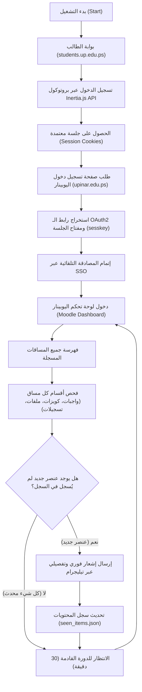

# 🔔 نظام مراقبة وتنبيهات اليوبينار (UPINAR Notifier)
### جامعة فلسطين - University of Palestine (E-Learning Automation)

نظام أتمتة ومراقبة ذكي وخفيف جداً، مصمم خصيصاً للربط بين **بوابة الطالب (Student Portal)** ومنصة التعليم الإلكتروني **اليوبينار (Moodle 4.x)** لجامعة فلسطين. يقوم النظام بفحص المساقات تلقائياً، وإجراء جرد دوري شامل لجميع المحتويات، وإرسال تنبيهات فورية مباشرة إلى هاتفك عبر **بوت تيليجرام** فور إضافة أي محاضرة، سلايد، واجب، أو كويز جديد.

---

## 🧠 آلية العمل والهندسة البرمجية (How It Works)

يعتمد النظام على محاكاة متقدمة لتدفق المصادقة الموحدة **(OAuth2 Single Sign-On - SSO)** دون الحاجة لتشغيل متصفحات ثقيلة (Headless Browsers) مثل Selenium أو Playwright، مما يجعله يعمل بسرعة فائقة وبأقل استهلاك للموارد (أقل من 35 ميجابايت رام).



### 1. مرحلة تسجيل الدخول المزدوج (SSO Authentication Flow):
1. **الاتصال بالبوابة الرئيسية:** يقوم النظام بعمل طلب `GET` لصفحة تسجيل الدخول في بوابة الطالب `https://students.up.edu.ps/login` لاستخراج إصدار الـ Inertia الحالي ورمز الـ `XSRF-TOKEN`.
2. **المصادقة وتوثيق الطالب:** يتم إرسال طلب `POST` مشفر بهوية الطالب (الرقم الجامعي وكلمة المرور) مع ترويسات `X-Inertia` المناسبة، وعند نجاح الاعتماد يتم تخزين كوكيز الجلسة (`boab-altalb-session`).
3. **استخراج توكن الجلسة (sesskey extraction):** يتم الانتقال إلى صفحة `https://upinar.edu.ps/login/index.php` وقراءة كود الـ HTML لاستخراج رابط الـ OAuth2 الديناميكي المرفق معه مفتاح الأمان `sesskey`.
4. **تفعيل الـ SSO:** يرسل النظام طلباً للرابط المستخرج؛ فيقوم خادم Moodle بالتحقق من جلسة بوابة الطالب المفتوحة ويُسجل الدخول فوراً وينشئ جلسة `MoodleSession`.

---

### 2. مرحلة الجرد والفحص الذكي (Scraping & Tracking):
1. **جرد المساقات (Courses Discovery):** يفحص النظام صفحة الـ Dashboard ويسحب كافة المساقات المسجلة للطالب (مثل: هياكل البيانات، الأمن السيبراني، أخلاقيات المهنة).
2. **استخراج الوحدات والأنشطة (Module Parsing):**
   - 📝 **الواجبات والتاسكات:** فحص روابط `/mod/assign/`.
   - ⏱️ **الكويزات والاختبارات:** فحص روابط `/mod/quiz/`.
   - 📄 **المحاضرات والملفات والشباتر:** فحص روابط `/mod/resource/` و `/mod/folder/`.
   - 🎥 **التسجيلات وروابط الزووم:** فحص روابط `/mod/url/`.
   - 📢 **الإعلانات:** فحص روابط `/mod/forum/`.
3. **المقارنة وكشف التحديثات (Diffing):** يحتفظ النظام بملف محلي خفيف `seen_items.json` يخزن المعرّفات الفريدة لكل نشاط؛ وأي عنصر لم يسبق رصده يتم تصنيفه فوراً كـ "محتوى جديد".

---

### 3. مرحلة الإشعارات (Instant Telegram Alerts):
- يتم إرسال التنبيه فوراً عبر **بوت تيليجرام** مع دعم تنسيق HTML المتكامل، متضمناً:
  - اسم المادة
  - نوع المحتوى (واجب / ملف / كويز / إعلان)
  - اسم الملف أو الواجب
  - رابط الفتح المباشر للعنصر.

---

## 📁 هيكلية ملفات المشروع:

| الملف | الوظيفة |
| :--- | :--- |
| `upinar_engine.py` | المحرك الأساسي للمراقبة الدورية وإرسال تنبيهات الجديد تلقائياً. |
| `detailed_report.py` | يولد تقريراً شاملاً فورياً بكل المواد والواجبات والمحاضرات الحالية إلى هاتفك. |
| `telegram_notifier.py` | موديول الاتصال ببوت التيليجرام وإرسال الرسائل بتنسيق HTML ورسائل الخطأ. |
| `storage.py` | موديول إدارة وحفظ السجل (`seen_items.json`) لمنع تكرار الإشعارات. |
| `start.bat` | تشغيل المراقبة التلقائية في الخلفية بنقرة زر واحدة على ويندوز. |
| `get_report.bat` | طلب تقرير جرد فوري وشامل لجميع المواد والشباتر بنقرة زر واحدة. |
| `setup.bat` | معالج إعداد تفاعلي وسهل لإدخال بيانات الحساب وتوكن البوت. |
| `config.example.json` | نموذج ملف الإعدادات المطلوب تعبئته. |
| `.gitignore` | حماية البيانات الشخصية وحجب ملفات الإعدادات والتوكنات عن الرفع إلى Git. |

---

## 🚀 طريقة التثبيت والإعداد:

### 1. المتطلبات الأساسية:
- تثبيت بايثون (Python 3.10 أو أحدث).
- تثبيت المكتبات المطلوبة بأمر واحد:
  ```bash
  pip install requests beautifulsoup4 urllib3
  ```

### 2. ضبط الإعدادات:
- أنشئ ملف `config.json` (أو شغل `setup.bat`) وضع بياناتك:
  ```json
  {
    "student_id": "رقمك_الجامعي",
    "password": "كلمة_مرور_بوابة_الطالب",
    "telegram_bot_token": "توكن_البوت_من_BotFather",
    "telegram_chat_id": "رقم_الـ_id_الشخصي_من_userinfobot",
    "check_interval_minutes": 30
  }
  ```

### 3. الاستخدام:
- **لبدء المراقبة الدورية المستمرة:** اضغط دبل كليك على `start.bat`.
- **لطلب جرد شامل بكافة محتويات المواد فوراً:** اضغط دبل كليك على `get_report.bat`.

---

## 🔒 الأمان والخصوصية (Security & Privacy):
- **حماية البيانات:** ملف الإعدادات الحقيقي `config.json` وملفات الجلسات `session_cookies.json` مدرجة تلقائياً في `.gitignore` لمنع رفع أي بيانات شخصية أو كلمات مرور أو توكنات إلى GitHub.
- **تشفير الاتصال:** تتم جميع العمليات عبر بروتوكول HTTPS المشفر مباشرة بين جهازك وسيرفرات الجامعة وتيليجرام دون وجود أي وسيط خارجي.
